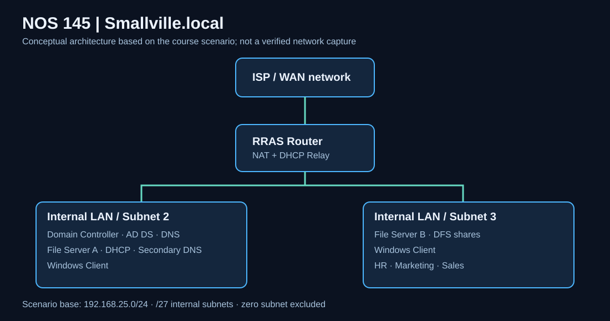

# Windows Server 2025 | Enterprise Infrastructure & Network Services Lab

**NOS 145 · Fall 2025 · Windows Server Administration / Network Services**

> **Portfolio case study — historical lab evidence.** This repository documents a simulated small-business infrastructure from a course scenario and the original screenshot worksheet. Configuration screens are evidence of lab work, not proof that every requirement passed an end-to-end test. The diagram is conceptual.

## Project in 60 seconds

| Business requirement | Technical approach | Evidence status |
|---|---|---|
| Centralized identity for HR, Marketing and Sales | Active Directory Domain Services, OUs, security groups | AD administration screens captured |
| Reliable name resolution | DNS primary/secondary-zone design | DNS console and zone settings captured |
| Automatic client addressing | DHCP scopes and relay across routed segments | DHCP and routing screens captured |
| Shared department resources | DFS namespace, shares and NTFS permissions | File-service and permission screens captured |
| Multi-subnet connectivity | Windows Server RRAS/NAT and subnet planning | Routing screens and command outputs captured |

**Environment:** Windows Server 2025 · Hyper-V · AD DS · DNS · DHCP · DFS · RRAS · NTFS  
**Domain in assignment:** `Smallville.local` · **Departments:** HR, Marketing, Sales

## Architecture at a glance



The scenario models a Windows Server router, domain controller, two file servers and two workstation VMs. The network plan uses `192.168.25.0/24` divided into `/27` segments (30 usable host addresses each). These are design requirements, **not** a claim of verified live topology.

[Network design and subnetting](documentation/NETWORK-DESIGN.md) · [Identity and permissions](documentation/IDENTITY-AND-ACCESS.md)

## Implementation evidence

Screenshots extracted from the student's populated worksheet are grouped for review:

| Area | Evidence | What to look for |
|---|---|---|
| Identity & AD DS | [Active Directory images](documentation/EVIDENCE-GALLERY.md#active-directory) | OU structure, users, group membership |
| Network addressing | [Networking images](documentation/EVIDENCE-GALLERY.md#networking) | Host interface configuration |
| DNS | [DNS images](documentation/EVIDENCE-GALLERY.md#dns) | Zones, transfers, SOA |
| DHCP | [DHCP images](documentation/EVIDENCE-GALLERY.md#dhcp) | Scopes, address leases |
| File services | [File-service images](documentation/EVIDENCE-GALLERY.md#file-services) | DFS, share/NTFS permissions |
| Routing | [Routing images](documentation/EVIDENCE-GALLERY.md#routing) | RRAS, NAT, relay, connectivity outputs |

### Representative screenshots

**Identity administration**  


**Network configuration**  


**Routing and network services**  


*Image captions identify evidence categories only; inspect full-size captures for exact settings.*

## Security and operational thinking

- **Least privilege:** Separate department access through groups and resource permissions; manager and employee roles have different intended privileges.
- **Access-control nuance:** Preventing deletion while allowing edits requires advanced NTFS permissions and effective-access testing, not a blanket `Modify` grant.
- **Resilience:** The assignment's secondary DNS and distributed file services address availability requirements; screenshots alone cannot establish successful failover.
- **Routing:** DHCP relay is needed when clients and DHCP servers are on different routed subnets.

[Read the identity/access design](documentation/IDENTITY-AND-ACCESS.md) · [Implementation and validation](documentation/IMPLEMENTATION-AND-VALIDATION.md)

## Verification and limitations

**Documented:** administrative consoles, selected policy/configuration dialogs, interface settings and command-output screenshots.  
**Not independently verified:** full end-to-end connectivity, all department access rules, successful failover, and current running infrastructure. No VMs were supplied for retesting.

See the [evidence and verification matrix](documentation/VERIFICATION-MATRIX.md) and [source limitations](documentation/SOURCE-AND-LIMITATIONS.md). This portfolio deliberately separates **assignment goals**, **visible evidence**, and **future validation**.

## Repository guide

```text
architecture/       Conceptual network topology (SVG)
documentation/      Design, evidence gallery, validation and limitations
screenshots/        37 extracted lab images grouped by service
README.md           Recruiter-friendly project overview
.gitignore          Excludes VM disks, secrets and temporary files
```

## What this project demonstrates

Windows Server administration, identity management, segmented network design, DNS/DHCP services, file-access planning, evidence-based technical documentation and the ability to communicate infrastructure decisions.

> **Publication check:** Screenshot captures may expose usernames, host identifiers, timestamps or other private details. Review each image before making the repository public. [Publishing checklist](documentation/PUBLISHING-CHECKLIST.md).
